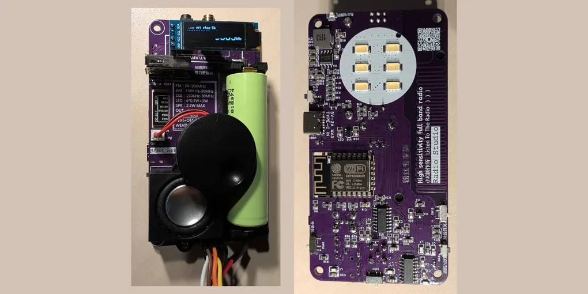

# Havoc Radio

Havoc Radio is open firmware for the Xiao K Workshop (小K制作所) "Radio Studio" pocket receiver, an ESP8266 and
Si4732 radio sold on AliExpress. It replaces the stock firmware, whose menus are only in Chinese, with an interface
driven by the radio's wheel, in English and 40 other languages.

## Features

- It receives FM from 64 to 108 MHz, and LW, MW and SW from 150 kHz to 30 MHz in AM, LSB and USB.
- The wheel tunes. Holding it while turning sets the volume, and a long press saves the frequency as a preset (up
  to 20).
- The band list holds every broadcast and amateur band from LW to 10 m. Each band remembers its last frequency.
- Seek runs up and down on FM and AM.
- On FM it shows the station's RDS name on the home screen, and its programme type and RadioText on a Station
  screen. The web page adds the traffic flags, the station code and the station's other frequencies.
- The menus set the step, bandwidth, AGC and display contrast.
- The side button goes back. Held for 1 s it turns the lamp on the back on or off; the lamp screen sets its level
  and flashes SOS in Morse code.
- The interface comes in 41 languages, each listed under its own name.
- A web page on the local network shows the frequency and signal live, tunes the radio, edits presets, sets up
  WiFi and uploads firmware. A new firmware only installs after a press of the knob on the radio.
- In AM, LSB and USB it shows the name of the station on air on the home screen, and the frequency's schedule on a
  Station screen, from a frequency guide converted from the [EiBi](http://www.eibispace.de/) shortwave schedule.
  The guide updates on request, from the radio's Settings or from the web page; the
  [havoc-radio-guide](https://github.com/hoverboardhavoc/havoc-radio-guide) repository keeps it current.
- The radio sets its clock in UTC from NTP while it is on a network and shows the time on the home screen. Settings
  turns NTP off. Its only other outside connection is the guide download, when one is asked for. Without a home
  network it runs its own access point `Havoc-Radio`.
- Havoc Radio installs over WiFi on a radio with the stock firmware, through the radio's own update menu, with no
  soldering: [docs/installer.md](docs/installer.md).

## Documentation

- [docs/user-guide.md](docs/user-guide.md): using Havoc Radio: the controls, the screens and every menu.
- [docs/installer.md](docs/installer.md): installing Havoc Radio with the Havoc Radio Installer on an ESP32-C3
  SuperMini, over WiFi on a radio with the stock firmware or over UART on any radio; flashing with a USB-UART
  adapter; updates.
- [docs/hardware.md](docs/hardware.md): the radio, where to buy it, its parts, pins and flash layout.
- [docs/translations.md](docs/translations.md): how the translations are kept and checked.
- [docs/guide-format.md](docs/guide-format.md): the frequency guide's table format.
- [docs/build-radio.md](docs/build-radio.md) and [docs/build-installer.md](docs/build-installer.md): building and
  testing the firmware and the installer.
- [radio/ui/prototype.html](radio/ui/prototype.html): the UI reference. Open it in a browser to try every screen;
  its fonts, string tables and behaviour are what the firmware renders.

## Frequency guide data

The frequency guide comes from EiBi, the shortwave schedule compiled by Eike Bierwirth
([eibispace.de](http://www.eibispace.de/)). EiBi's README says: "any person is absolutely free to download, use, copy,
or distribute these files or to use them within third-party software."

## The radio

Where to buy it: [Aisanray Tech Official Store on AliExpress](https://s.click.aliexpress.com/e/_c3crzxeF)
(affiliate link). [docs/hardware.md](docs/hardware.md) has the radio's other names, its parts and pins, and the
flash layout.

## Building

| Folder | Contents | Build |
|---|---|---|
| `radio/` | Havoc Radio, the K-Radio's firmware (ESP8266) | [docs/build-radio.md](docs/build-radio.md) |
| `installer/` | The Havoc Radio Installer for an ESP32-C3 SuperMini | [docs/build-installer.md](docs/build-installer.md) |
| `docs/` | The guides and pictures | |
