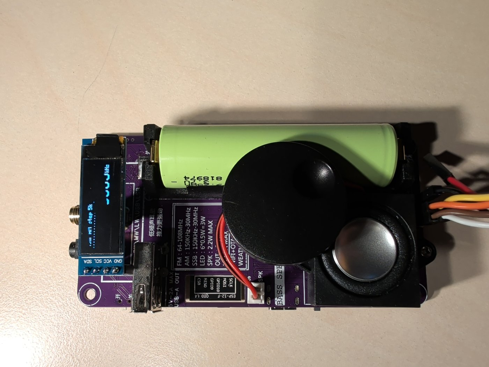
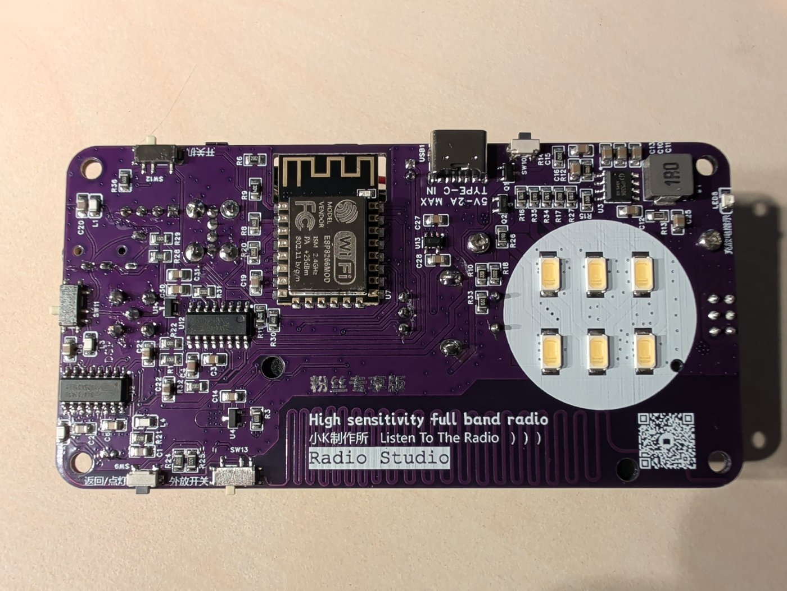

# Hardware

## The radio

Havoc Radio runs on a pocket receiver made by 小K制作所 (Xiao K Workshop) and sold assembled on AliExpress. It has
no model number. Its names:

| Where | Name |
|---|---|
| Back of the board | "Radio Studio", "High sensitivity full band radio", 小K制作所, 粉丝专享版 (fan edition) |
| Stock firmware | 小K收音机 ("Xiao K radio"); boot splash 小K制作所; WiFi access point `K-Radio` |
| AliExpress title | "Assembled 150K-30MHz FM SW MW LW SSB(USB LSB) SSB Full Band Radio High Sensitivity Intelligent Radio with 2500mAH 18650 Battery" |
| Reviews | "XIAOK" |

Where to buy it: [Aisanray Tech Official Store on AliExpress](https://s.click.aliexpress.com/e/_c3crzxeF)
(affiliate link). The listing photos show the stock firmware's clock screen: a weather icon and temperature on the
left, the time in seven-segment digits on the right, and the date below.

HamTech M0FXB reviewed it in November 2023:
[XIAOK Budget VHF/ HF Receiver with WIFI & USB C](https://www.youtube.com/watch?v=mAi9EzQYyLg).

The same maker's newer K3 (150 kHz to 1300 MHz) is a different radio; Havoc Radio has not been tried on it.

## Printed specifications

From the front silkscreen:

| | |
|---|---|
| FM | 64 to 108 MHz |
| AM | 150 kHz to 30 MHz |
| SSB | 150 kHz to 30 MHz |
| Lamp | 6 LEDs, 0.5 W each (3 W), on the back |
| Speaker | 2.2 W maximum |
| USB-A output | 5 V, 2 A maximum |
| USB-C input | 5 V, 2 A maximum, charging only |
| Battery | one 18650 cell (2500 mAh in the listing) |

## Parts and pins

| Function | Part / pin | Notes |
|---|---|---|
| MCU | ESP8266EX on an ESP-12F module, 4 MB flash | |
| Receiver | Si4732-A10, I2C address `0x11` | 32.768 kHz crystal on RCLK |
| Display | SSD1306 128x32 OLED, I2C address `0x3C` | |
| I2C bus | SDA GPIO4, SCL GPIO5 | Shared by the receiver and the display |
| Receiver reset | GPIO2, active low | Boot strap pin; high at boot through its pull-up |
| Amplifier mute | GPIO0, high = muted | LM4863 shutdown. Boot strap pin; high at boot, so the amplifier starts muted |
| Encoder | A GPIO14, B GPIO13, push GPIO12 | Active low |
| Side button | GPIO3 (UART0 RX), active low | Labelled 返回/点灯 (back / lamp). Using it gives up UART0 receive; the log uses UART0 transmit (GPIO1). |
| LED | GPIO15, red | Boot strap pin; low at boot |
| Battery | A0 | Through a divider from the IP5306 battery rail. Raw below 750 is empty; 850 to 990 is empty to full. |
| Power | IP5306 charger and boost, slide switch | The USB-C port has no data lines to the ESP8266 |
| Audio | LM4863 to the speaker and the 3.5 mm jack | A slide switch (外放开关) turns the speaker off |
| Antenna | SMA socket | FM and AM share it |

## UART header

U15 is six unpopulated holes at the battery end of the board, labelled TXD, IO0 and GND above RXD, EN and VIN. A
2×3 piece broken off a right-angle double-row 2.54 mm pin header fits it. Installing over it:
[installer.md](installer.md#install-over-uart).

## Flash layout

| Firmware | Layout |
|---|---|
| Stock | Arduino ESP8266 core 3.0.2: the eboot loader at `0x0`, the app at `0x1000`, the `eagle.flash.4m.ld` layout |
| Havoc Radio | bootloader `0x0`, partition table `0x8000`, nvs `0x9000` (16 KB), otadata `0xd000` (8 KB), phy_init `0xf000` (4 KB), ota_0 `0x10000` (960 KB), ota_1 `0x110000` (960 KB) |

Flash mode DIO, 40 MHz, 4 MB.
