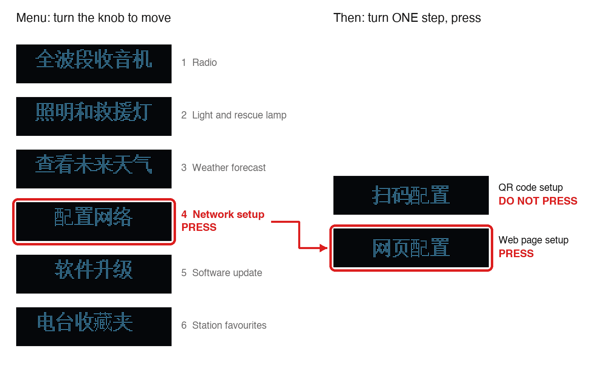
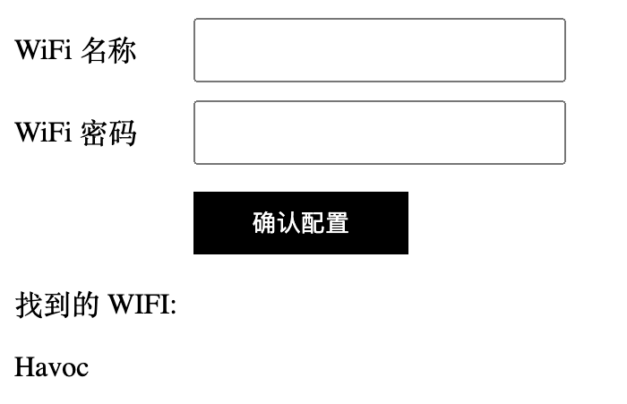
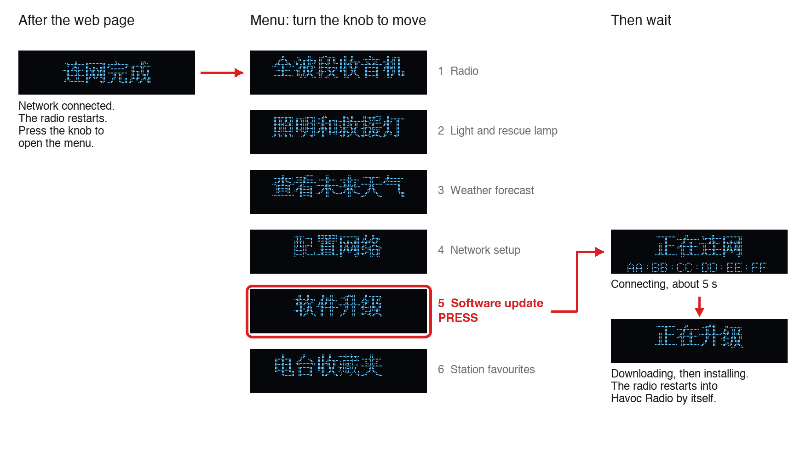
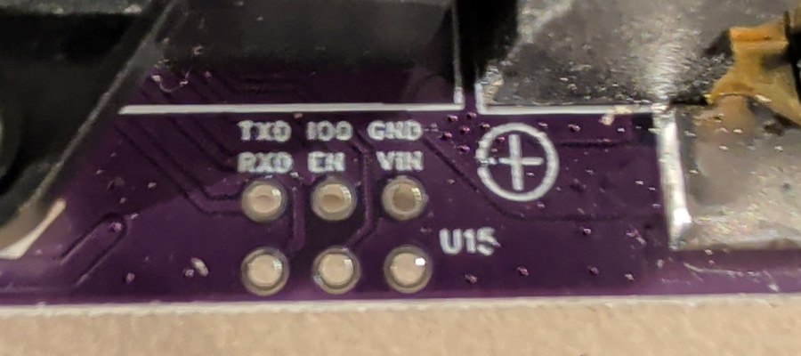
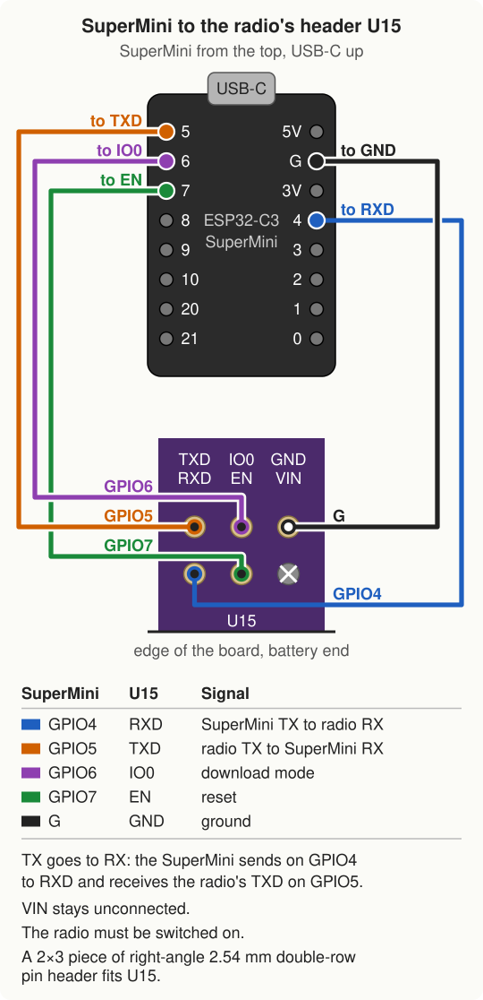

# Installing Havoc Radio

## How it works

An [ESP32-C3 SuperMini](https://s.click.aliexpress.com/e/_c3Q1c9GJ) (affiliate link), a small development board
with WiFi, flashes the Havoc Radio firmware onto the Xiao K Workshop radio. The installer firmware is flashed onto
the SuperMini once, from a computer. After that the SuperMini needs only USB power.

The SuperMini installs Havoc Radio in one of two ways:

- **[Over WiFi](#install-over-wifi)**, on a radio that still runs its stock (K-Radio) firmware. There is no cable and no soldering: the
  radio downloads Havoc Radio from the SuperMini through its own update menu.
- **[Over UART](#install-over-uart)**, through the radio's UART header U15, on any radio, also one that does not
  start. This needs a small header soldered on and five wires.

The SuperMini runs its own WiFi access point, `Havoc`, and shows each install's progress on a web page on it.

Requirements:

- the radio: the Xiao K Workshop (小K制作所) "Radio Studio" full band radio
- an ESP32-C3 SuperMini or [SuperMini Plus](https://s.click.aliexpress.com/e/_c3Q1c9GJ) (affiliate link)
- a computer, to flash the SuperMini once
- a USB power supply or power bank for the SuperMini
- a phone or laptop, for the installer's page
- for the UART install only: a 2×3 piece of right-angle 2.54 mm double-row pin header, a soldering iron and five
  female-to-female Dupont jumper wires

## Flash the SuperMini

Download `havoc-radio-installer.bin` from the [latest release](https://github.com/hoverboardhavoc/havoc-radio/releases/latest). It holds the installer and the
Havoc Radio it installs. To build it instead, see [build-installer.md](build-installer.md).

Connect the SuperMini over its USB-C port and flash the file at `0x0` with
[esptool](https://docs.espressif.com/projects/esptool/en/latest/esp32c3/) (`pip install esptool`):

```sh
esptool.py --chip esp32c3 -p PORT write_flash 0x0 havoc-radio-installer.bin
```

`PORT` is the SuperMini's USB serial device, for example `/dev/cu.usbmodem1101`. If esptool cannot connect, hold
the BOOT button while plugging the SuperMini in, then run the command again.

## Install over WiFi

This method works on a radio that runs the stock firmware. The radio is not opened and nothing is soldered. The
radio joins the installer's access point `Havoc` instead of a home network. The stock firmware updates from the
vendor's server `iotc.kuailece.cn`; on `Havoc` that name points to the SuperMini, so the radio downloads Havoc Radio
from the SuperMini. The install takes about five minutes.

Power the SuperMini from any USB supply within a few metres of the radio. It starts the open access point `Havoc`
([details](#the-installers-wifi-access-point)).

### Connect the radio to `Havoc`

1. Open the menu (press the knob on the clock screen). Turn until the page ringed in red shows and press. The next
   screen shows the QR code method first: **DO NOT PRESS IT** (it ignores the knob for 100 s). Turn ONE step, to
   the web page method ringed in red, and press.

   

2. The radio now alternates between two screens. Together they say "connect to the WiFi hotspot K-Radio and
   enter 192.168.4.1 in the browser":

   

   

   On a phone, join the open WiFi network `K-Radio` (if the phone warns that it has no internet, stay connected)
   and open `http://192.168.4.1` in a browser. Some phones open the page by themselves.
3. The page has two fields and a black button:

   

   Type `Havoc` (the installer's access point) in the first field (WiFi 名称, WiFi name), leave the second (WiFi 密码,
   password) empty, and press the button (确认配置, confirm). Below the button the page lists the networks the radio
   found (找到的 WIFI); `Havoc` should be among them.
4. The radio shows this and restarts:

   

   If it shows this instead, the radio could not join `Havoc`; check that the SuperMini is powered and nearby, then
   enter the name again on the `K-Radio` page:

   

### Run the update

1. After the restart, press the knob to open the menu, turn until the page ringed in red shows, and press:

   

2. The radio connects, with its MAC address on the bottom line, and about 5 seconds later shows this while it
   downloads about 2 MB, which takes 20 to 25 seconds. The SuperMini's LED blinks fast. To follow the download on a phone, join it to `Havoc`
   and open `http://192.168.4.1`: the page's Downloads section shows the radio's MAC address and the bytes sent.
   The install runs the same without the phone.

   

3. When the download is complete, the row says "sent every byte". The radio copies Havoc Radio into place and
   restarts into it by itself, then shows the Havoc Radio splash, the rolling wheel. Do not switch the radio off
   before then.

If the radio shows this instead of the download screen, the update did not run and the stock firmware is
unchanged; check the page's Downloads section and try again:


A download that says "stopped early" changes nothing: the stock firmware keeps running, and the update can be run
again. "Refused: no image" means the installer has no complete image the WiFi install can use.

Havoc Radio starts with empty settings and its own access point `Havoc-Radio`; set up WiFi again in Settings >
WiFi or on its web page.

## Install over UART

This method works on any radio: one on the stock firmware, one on Havoc Radio, or one that does not start (for
example after the power was lost during a WiFi install). The radio's USB-C port only charges; the installer reaches
the ESP8266 through its UART header U15.

U15 is six unpopulated holes at the battery end of the board, labelled TXD, IO0 and GND above RXD, EN and VIN:



1. Solder a 2×3 piece of right-angle double-row 2.54 mm pin header into U15.
2. Wire the SuperMini to the header with five female-to-female Dupont jumper wires. VIN stays unconnected: the
   radio runs on its own battery.

   

3. Switch the radio on. With the slide switch off the ESP8266 has no power, even with USB-C connected.
4. Power the SuperMini from any USB supply. Join its access point `Havoc` with a phone or laptop; the installer's
   page opens by itself, or open `http://192.168.4.1` ([details](#the-installers-wifi-access-point)).
5. On the installer's page, open UART install and press Install. The SuperMini puts the radio into download mode
   itself, writes each region of the image, compares each region's MD5 with the image and restarts the radio. The
   page shows each region as it is written and verified.

The result on the page:

- "Installed and verified every region": the radio restarts into Havoc Radio.
- "Failed" with "could not reach the radio": the radio never answered. Check that the radio is switched on, the
  five wires, and that TX goes to RX: GPIO4 to RXD, GPIO5 to TXD. Then press the button again.
- "Failed" after the radio answered: a region did not verify after three rewrites. Press the button again.

The console must be closed while installing, on this page and any other. The page's Console section shows the
radio's serial output at 74880 baud, the rate of the boot ROM, the bootloader and Havoc Radio: press Reset there
to see the boot log.

## Without the installer

With a 3.3 V USB-UART adapter and no SuperMini, esptool flashes the radio over the same header.

| Header | Adapter | Notes |
|---|---|---|
| TXD | RX | |
| RXD | TX | |
| GND | GND | |
| IO0 | not connected (jumper cap to GND, below) | Low at power-on selects the ROM download mode |
| EN | not connected | |
| VIN | not connected | The radio powers itself from its battery |

IO0 and GND sit next to each other in the header's top row, so a 2.54 mm jumper cap bridges them:

1. Switch the radio off.
2. Put a jumper cap across IO0 and GND.
3. Switch the radio on. It starts in download mode, with a blank screen.

Fit the cap only while the radio is off: Havoc Radio drives IO0 high, and the cap would short it. With an adapter
that wires DTR to IO0 and RTS to EN, esptool can do this itself: leave IO0 and EN on the adapter, skip the cap,
and change `--before no_reset` to `--before default_reset` below.

From the repository root, after `make firmware`:

```sh
radio/third_party/venv/bin/python radio/third_party/ESP8266_RTOS_SDK/components/esptool_py/esptool/esptool.py \
  -p PORT -b 460800 --before no_reset --after hard_reset write_flash \
  --flash_mode dio --flash_freq 40m --flash_size 4MB \
  0x0 radio/build/bootloader/bootloader.bin \
  0x8000 radio/build/partition_table/partition-table.bin \
  0xd000 radio/build/ota_data_initial.bin \
  0x100000 radio/build/havoc-radio.bin
```

`PORT` is the adapter's serial device, for example `/dev/cu.usbserial-0001`. If esptool reports that it cannot
connect, switch the radio off and on with the cap still fitted and rerun the command. If it fails partway, lower
`-b 460800` to `115200`. After the flash, switch the radio off, remove the jumper cap, and switch it on again.

## Updating the installer

The installer updates its own firmware over WiFi, so the SuperMini can stay on any USB power supply. The update
is `installer.bin` from the [latest release](https://github.com/hoverboardhavoc/havoc-radio/releases/latest), or `installer/build/installer.bin` from a build. The merged
`havoc-radio-installer.bin` is only for the first flash over USB.

On the page, open the Installer section, press Update installer and choose `installer.bin`. The
page shows the upload, the installer's answer, the restart, and the version it came back with. From a computer on
the installer's network:

```sh
installer/tools/installer-update
```

sends the same file (`--host` names the installer when it is not at `192.168.4.1`) and reports the new version once
it runs.

The installer writes the new firmware next to the running one and checks it before it restarts into it. The new
firmware confirms itself once its page has answered for 30 seconds. If it does not come up, or the SuperMini
restarts before then, the SuperMini goes back to the previous firmware, and the page and `installer-update` report
the update as rolled back. The home network and the carried image stay as they are.

## After installing

Updates go through Havoc Radio's own web page: Firmware, choose `havoc-radio.bin` from the
[latest release](https://github.com/hoverboardhavoc/havoc-radio/releases/latest), Upload, then press the knob on the
radio within 30 s to install.

To put a newer Havoc Radio on the installer itself, upload `havoc-radio-install.bin` from the release in the page's
Carried firmware section. From a computer on the installer's network, `radio-flash` uploads a build to the
installer and installs it over UART in one step (`--host` names the installer when it is not at `192.168.4.1`):

```sh
installer/tools/radio-flash --project-args radio/build/flash_project_args
```

The installer can also join a home network, set in the page's
Settings section, so the page and `radio-flash` work from any computer there.

## The installer's WiFi access point

Powered from any USB supply, the SuperMini starts its own WiFi access point:

| | |
|---|---|
| Network name | `Havoc` |
| Password | none (open network) |
| Installer page | `http://192.168.4.1`; most phones open it by themselves after joining |
| Range | a few metres; keep the SuperMini near the radio and the phone |

The network has no internet connection; if the phone warns about that, stay connected. Every section of the page
starts with what it does, and its "How" link has the details. The network and the page are open to anyone nearby,
so power the SuperMini only while installing or working on a radio.

| LED | Meaning |
|---|---|
| Blinks once a second | Ready |
| Blinks five times a second | A radio is downloading, a UART install runs, or the installer updates itself |
| On for 10 seconds | A download or a UART install completed |
| Three short blinks every 2 seconds | No complete image to install; upload one on the page |

On the SuperMini Plus, GPIO8 drives an RGB LED (WS2812), so these signals may not show; the page shows the same
state.

The SuperMini logs every step (devices joining, DNS names, downloads, UART installs) on its USB serial port.
