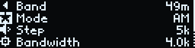
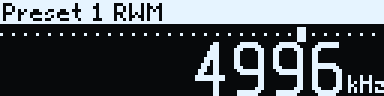
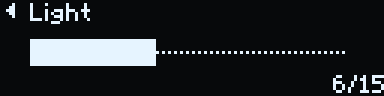
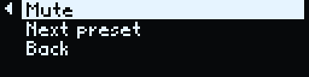

# Havoc Radio user guide

Havoc Radio is open firmware for the Xiao K Workshop (小K制作所) "Radio Studio" pocket receiver, called the K-Radio
in these guides. This guide describes how to use the K-Radio once Havoc Radio is installed.
[installer.md](installer.md) describes how to install it.

The pictures are the K-Radio's own screens, enlarged three times. The screen is 128 by 32 pixels.

- [Switching on](#switching-on)
- [Controls](#controls)
- [The home screen](#the-home-screen)
- [The main menu](#the-main-menu)
- [Station (RDS)](#station-rds)
- [Presets](#presets)
- [Settings](#settings)
- [Typing a WiFi password](#typing-a-wifi-password)
- [The web page](#the-web-page)
- [Firmware updates](#firmware-updates)
- [Battery](#battery)

## Switching on

The slide switch turns the K-Radio on and off. At power-on the K-Radio shows its splash for 2.6 s: the Hoverboard
Havoc wheel rolls in with flames behind it, then `HOVERBOARD`, `HAVOC` and `radio` appear. Any input skips the
splash. That input does nothing else.

The home screen follows. The K-Radio starts on the frequency, mode and volume it had when it was switched off. It
keeps its presets and settings as well. Changes are stored at most once every 5 s, so wait a few seconds after a
change before switching off. WiFi starts when the splash ends.

The USB-C port charges the battery. It carries no data.

## Controls

The K-Radio has a wheel, which turns in clicks and also presses, and a side button.

| Input | How | On the home screen | In a menu |
|---|---|---|---|
| Turn | Turn the wheel. Each click is one step. | Tunes by the step | Moves the selection |
| Press | Press the wheel and let go. | Opens the main menu | Chooses the selected entry |
| Long press | Hold the wheel down for 0.6 s without turning. | Saves the frequency as a preset | Goes to the home screen |
| Hold + turn | Hold the wheel down and turn it. | Sets the volume | Jumps four entries |
| Side button | Press the side button. | Mute, next preset or back, as set in Settings | The same |

Turning clockwise raises the frequency, moves the selection down a list and raises a value. Turning anticlockwise
does the opposite. In text entry, hold + turn jumps to the next group of characters.

The side button mutes by default. [Settings > Side button](#side-button) changes it to step through the presets or
to go back one screen.

Any input stops a running seek.

## The home screen

The top row shows, from the left:

- the band name (`49m`),
- the mode (`AM`, `FM`, `LSB` or `USB`),
- the tuning step (`step 5k`),
- five signal bars at the right.

Below the top row a dotted line stands for the band. The marker on it shows where the frequency sits inside the band.
The frequency is in large digits, with its unit (`kHz` or `MHz`) at the bottom right.

### Tuning

Turn the wheel to tune. Each click moves the frequency by the step shown in the top row. There are no band edges.
AM, LSB and USB tune from 150 kHz to 30 MHz. FM tunes from 64 to 108 MHz. The band name follows the frequency.

Outside a named band the band name is `LW` below 300 kHz, `MW` below 1800 kHz and `SW` above. The band line is then
left out.

FM shows the frequency in MHz with two decimals. The band name and the mode both read `FM`.

When an FM station sends RDS, its name (the PS, up to 8 characters) replaces the band name and the mode in the top
row. The name builds up character by character as the K-Radio receives it. A tune, a seek or a band change clears it
until the new station's name arrives.

In LSB and USB, with a step of 10 Hz or 100 Hz, the frequency shows two decimals in kHz.

### Signal bars

The bars show the signal strength. The first bar lights at 10 dBµV on LW, MW and SW and at 15 dBµV on FM. Each
further bar needs 10 dBµV more. An unlit bar shows as a dot.

### Volume and mute

Hold the wheel down and turn it to set the volume. The top row then shows a speaker, a bar and the volume from 0 to
63. The top row returns 1.5 s after the last change. A change of volume also turns mute off.

While the K-Radio is muted, the top row shows the `Mute` flag. In some languages the step is left out of the top row
while muted, so that the flag fits.

### Messages in the top row

Short messages replace the top row for 1.5 s, in inverted text.

| Message | Cause |
|---|---|
| `Muted`, `Sound on` | The side button, set to Mute, was pressed. |
| `Saved as preset 6` | A long press saved the frequency as preset 6. |
| `Presets full` | A long press found 20 presets already saved. |
| `Preset 1 RWM` | The side button, set to Next preset, tuned preset 1, named RWM. |
| `No presets` | The side button, set to Next preset, found no presets. |
| `No seek in SSB` | A seek was started in LSB or USB. |
| `Joining Telenor-5G` | A WiFi password was entered for the network Telenor-5G. |
| `Update cancelled` | A firmware update was cancelled on the K-Radio. |

During a seek the top row shows the band and `Seek ▶` (up) or `Seek ◀` (down).

## The main menu

Press the wheel on the home screen to open the main menu.

The screen shows four rows at a time. The selected row is inverted. The current value of each entry is at the right.
A dotted bar at the right edge shows that the list holds more entries than fit. The main menu holds Band, Mode, Step,
Bandwidth, Volume and Seek. On FM it also holds Station, after Seek.

The narrow column at the left edge holds icons that can be selected:

| Icon | Name | Press it to |
|---|---|---|
| `◀` | Back | return to the previous screen. On the main menu it returns to the home screen. |
| star | Presets | open the preset list. See [Presets](#presets). |
| speaker | Mute | mute or unmute. The menu stays open. The speaker is crossed out while muted. |
| gear | Settings | open Settings. See [Settings](#settings). |

### Moving around a menu

These rules hold in every list.

- The selection travels round the screen in one loop. Turning clockwise moves down the entries. After the last entry
  the selection moves to the lowest icon in the left column, then up the column to Back, then to the first entry.
  Turning anticlockwise goes the other way, so one click up from the first entry selects Back.
- Hold + turn jumps four entries. It stops at the first and the last entry.
- A list opens with the current value selected.
- Choosing a band, mode, preset, step or bandwidth returns to the home screen.
- A long press returns to the home screen from any menu.
- After 8 s without input the K-Radio returns to the home screen. Text entry, the Station screen and the firmware
  update screen do not time out.

### Band

Each row shows the band's name and its range. LW and MW ranges are in kHz (`531-1602k`). The other ranges are in MHz
(`5.90-6.20`). Amateur bands carry `LSB` or `USB` at the right. The list runs from low to high frequency:

| Kind | Bands | Mode |
|---|---|---|
| FM broadcast | FM, 87.5 to 108 MHz | FM |
| Long and medium wave | LW, 153 to 279 kHz; MW, 531 to 1602 kHz | AM |
| Shortwave broadcast | 120, 90, 75, 60, 49, 41, 31, 25, 22, 19, 16, 13 and 11 m | AM |
| Amateur | 160, 80, 40, 20, 17, 15, 12 and 10 m | LSB below 10 MHz, USB above |
| Citizens band | CB, 26.965 to 27.405 MHz | AM |

Choosing a band tunes the K-Radio to the frequency last used in that band, in the band's mode. The K-Radio then
returns to the home screen. Each band remembers its own last frequency.

### Mode

The modes are `AM`, `LSB` (`lower SSB`) and `USB` (`upper SSB`). LSB and USB receive single-sideband signals, which
radio amateurs use for voice. Choosing a mode keeps the frequency and returns to the home screen.

On FM the list holds only `FM`, marked `only on FM`. To leave FM, choose another band in the Band list.

If the Mode list offers only AM outside FM, the firmware on the K-Radio has no SSB support. The amateur bands then
open in AM.

### Step

The step is how far one click of the wheel tunes. FM, AM and SSB (LSB and USB) each keep their own step.

| Mode | Steps |
|---|---|
| FM | `50k`, `100k`, `200k` |
| AM | `1k`, `5k`, `9k`, `10k` |
| LSB, USB | `10Hz`, `100Hz`, `1k`, `5k` |

MW stations sit 9 kHz apart in Europe, Africa and Asia and 10 kHz apart in the Americas. Seek uses the step as its
spacing. In LSB and USB, the 10 Hz and 100 Hz steps fine-tune a station until the voice sounds natural.

### Bandwidth

The bandwidth sets how wide a slice of the band the receiver lets through. A narrower bandwidth lets through less
noise and less of the neighbouring stations. A wider one carries more of the audio. FM, AM and SSB each keep their
own bandwidth.

| Mode | Bandwidths |
|---|---|
| FM | `Auto`, `110k`, `84k`, `60k`, `40k` |
| AM | `1.0k`, `1.8k`, `2.0k`, `2.5k`, `3.0k`, `4.0k`, `6.0k` |
| LSB, USB | `0.5k`, `1.0k`, `1.2k`, `2.2k`, `3.0k`, `4.0k` |

### Volume

The volume screen shows a bar and the value out of 63. Turn the wheel to change the volume; it changes as the wheel
turns. Press the wheel to return to the home screen. A change of volume turns mute off. While the K-Radio is muted,
the main menu shows `mute` as the volume.

Hold + turn on the home screen sets the volume without opening the menu.

### Seek

Choose `Seek up` or `Seek down`. The K-Radio returns to the home screen and searches for the next station in that
direction. It stops on the first station it finds. Inside a named band the search covers that band. Outside one it
covers LW, MW, SW or FM, whichever holds the frequency. At the end of the range the search wraps round to the other
end. The search moves in steps of the current step.

Turning the wheel, pressing it or pressing the side button stops a seek. Seek works on FM and AM. In LSB and USB the
K-Radio shows `No seek in SSB`.

## Station (RDS)

Many FM stations send RDS (Radio Data System) alongside the sound: the station's name, the kind of programme and a
line of text, often the song and artist or the show. The K-Radio shows them on FM. It does not switch frequency or
programme on its own because of RDS.

Open the main menu on FM, select `Station` and press.

The top row shows the station's name at the left and the programme type at the right, for example `News`, `Pop
music` or `Weather`. The rows below show the RadioText, broken into lines at the spaces. When the text needs more than
three rows, turning the wheel scrolls it a row at a time. The screen follows the station while it is open: the text
changes as new characters arrive, and a new text starts again at its first row.

A station that sends a name but no text shows the top row alone. While the K-Radio receives no RDS, the screen shows
`No RDS`.

Press the wheel to return to the main menu. A long press returns to the home screen. The Station screen stays open
without input, so that a long text can be read to the end.

## Presets

A preset holds a frequency, a mode and a name of up to 10 characters. The K-Radio holds up to 20 presets.

### Saving a preset

Long-press the wheel on the home screen. The top row shows `Saved as preset 6`, with the new preset's number. On FM,
when the top row shows the station's RDS name, the preset is named after the station, for example `-METRO-`.
Otherwise it is named after the band, for example `49m`, or `SW` outside a named band. With 20 presets saved, the K-Radio
shows `Presets full` and saves nothing.

### Choosing a preset

Open the main menu, select the star in the left column and press.

Each row shows the preset's number and name, with its frequency at the right (`9996k`, or `100.7M` on FM). The list
opens on the preset at the current frequency. Choosing a preset tunes to it, in its own mode, and returns to the home
screen. An empty list opens with Back selected.

### Next preset on the side button

With [Settings > Side button](#side-button) set to `Next preset`, each press of the side button tunes the next preset
in the list. After the last preset it starts again at preset 1. The top row shows the preset's number and name. With
no presets saved, the K-Radio shows `No presets`.

### Editing presets

The K-Radio has no screens for renaming, moving or deleting presets. The [web page](#the-web-page) does this. It can
also save the current frequency under a name of choice.

## Settings

Open the main menu, select the gear in the left column and press.

| Entry | Value shown | Press it to |
|---|---|---|
| WiFi | the joined network, or `not joined` | open the WiFi list |
| AGC | `on` or `off` | switch AGC on or off |
| Contrast | 1 to 15 | set the screen contrast |
| Light | 1 to 15, or `off` | set the light's brightness |
| Side button | `mute`, `preset` or `back` | choose what the side button does |
| Language | the language's name | choose the language |
| About | | show the version, address and battery level |

Back in Settings returns to the main menu.

### WiFi

After the splash, the K-Radio joins the WiFi network it has saved. If it has none, or cannot join it within 15 s, it
starts its own open access point `Havoc-Radio` at `192.168.4.1`. It keeps looking for the saved network meanwhile.

The first row, `Status`, shows `radio.local` when the K-Radio has joined a network and `not joined` when it has not.
The rows below list the networks the K-Radio found nearby, each with one to three signal bars. A tick marks the
joined network.

Press `Status` to see the connection. When the K-Radio has joined a network, the screen shows the network's name,
`radio.local` and the K-Radio's address. When it has not, the screen shows the access point `Havoc-Radio`. Press the wheel to return.

To join a network:

1. Select the network in the list and press. The password screen opens.
2. Type the password, as described in [Typing a WiFi password](#typing-a-wifi-password). For an open network, type
   nothing.
3. Choose `OK`. The K-Radio returns to the home screen and shows `Joining` with the network's name.

Open Settings > WiFi afterwards to check the result. The [web page](#the-web-page) can also set the network and
password.

### AGC

AGC (automatic gain control) evens out the level of strong and weak signals. Press the AGC row to switch it between
`on` and `off`. The selection stays on the row.

### Contrast

Contrast sets the screen's brightness from 1 to 15. Turn the wheel to change it; the screen changes as the wheel
turns. Press the wheel to return to Settings.

### Light

Light sets the brightness of the K-Radio's red light from 0 to 15. At 0 the light is off. Settings then shows `off`.
Press the wheel to return to Settings.

### Side button

Choose what the side button does. The K-Radio returns to Settings, which shows the choice as `mute`, `preset` or
`back`.

- `Mute` (the default) mutes or unmutes on any screen. The top row shows `Muted` or `Sound on`.
- `Next preset` tunes the next preset, as described in [Presets](#next-preset-on-the-side-button).
- `Back` does what Back in the left column does. In a list it returns one level. On the volume, contrast and light
  screens it keeps the value and leaves the screen, as a press does. In text entry it cancels and returns to the WiFi list. On the home screen
  it does nothing.

On the firmware update screen the side button cancels the update, whatever its setting.

### Language

The K-Radio speaks 41 languages. Each one is listed under its own name: English, Norsk, Svenska, Dansk, Deutsch,
Français, Español, Italiano, Nederlands, Polski, Čeština, Português, Suomi, Afrikaans, Català, Galego, Euskara,
Gaeilge, Shqip, Bahasa Indonesia, Bahasa Melayu, Kiswahili, Tagalog, Walon, Íslenska, Føroyskt, Eesti, Slovenčina,
Hrvatski, Bosanski, Slovenščina, Srpski (Latin), Magyar, Română, Türkçe, Azərbaycanca, Latviešu, Lietuvių, Malti,
Cymraeg and Esperanto.

Choosing a language changes the K-Radio and the web page at once. The K-Radio returns to Settings. Units, band names
and mode names read the same in every language. Some translations use short forms to fit the screen.

### About

About shows the Havoc Radio version, the K-Radio's address on the network and the battery level. On its own access
point the address is `192.168.4.1`. The battery level is read every 10 s. Press the wheel to return.

## Typing a WiFi password

The password screen opens when a network is chosen in Settings > WiFi.

- The top row shows `Password for` and the network's name. The current group of characters is at the right.
- The second row shows the typed text and a caret. Long text scrolls so that its end stays in view.
- The bottom row is the character ring. The selected character is in the middle, inverted.

The ring holds five groups, in this order:

| Group | Characters |
|---|---|
| `abc` | `a` to `z` |
| `ABC` | `A` to `Z` |
| `123` | `0` to `9` |
| `#+=` | `! @ # $ % & * - _ . + = ? / : ; , ' " ( )` |
| `edit` | `␣` (space), `DEL`, `OK` |

The ring wraps round: after `OK` comes `a` again.

### Typing

1. Turn the wheel to bring a character to the middle.
2. Press the wheel to type it.
3. Hold the wheel down and turn it to jump to the first character of the next group (clockwise) or the previous group
   (anticlockwise).

### Editing and finishing

- `␣` types a space.
- `DEL` deletes the last character.
- `OK` saves the password and joins the network.

A long press cancels and returns to the home screen. With the side button set to Back, the side button cancels and
returns to the WiFi list. The password screen does not time out. A password holds at most 64 characters.

## The web page

The K-Radio serves a web page on the local network. A phone or computer on the same network opens it in a browser.

### Opening the page

- When the K-Radio has joined a network, open `http://radio.local`. If that name does not open, use the address
  shown in Settings > WiFi > Status or in Settings > About, for example `http://192.168.0.57`.
- When the K-Radio runs its own access point, join the open network `Havoc-Radio` and open `http://192.168.4.1`.

### What it does

- It shows the frequency, band, mode and signal, and updates them twice a second. The signal shows as bars, with the
  strength in dBµV and the signal-to-noise ratio in dB.
- On FM, the frequency section also shows the station's RDS: its name, the RadioText, the programme type, `TP` when the
  station carries traffic news (highlighted during a traffic announcement) and the station code (`PI`). `Also on`
  lists the other frequencies that carry the same programme; a frequency there tunes the K-Radio to it. Without RDS
  it shows `RDS: searching`.
- The `-` and `+` buttons tune by the step. A frequency typed into the box (in MHz on FM, in kHz otherwise) tunes the
  K-Radio when `Tune` is pressed.
- Menus pick the band, mode, step and bandwidth. A slider sets the volume. A tick box mutes the K-Radio.
- Under `Presets`, a preset's name tunes it. The buttons beside it rename (✎), move up (↑), move down (↓) and delete
  (✕) the preset. `Add current` saves the current frequency under the name typed in the `Name` box.
- Under `WiFi`, type the network's name into `Network` and its password into `Password`, then press `Join`.
- Under `Firmware`, `Upload` installs new firmware (see [Firmware updates](#firmware-updates)). The section also shows
  the version and the battery level.

The page uses the language chosen on the K-Radio. It shows `No connection` at the top right while it cannot reach
the K-Radio.

The page has no password. Anyone on the same network can tune the K-Radio and change its presets. Installing
firmware needs a press of the wheel on the K-Radio itself. The K-Radio makes no connections to the internet.

## Firmware updates

New Havoc Radio firmware installs from the web page. The firmware file is `havoc-radio.bin`;
[installer.md](installer.md#after-installing) says where it comes from.

1. Open the web page. Under `Firmware`, choose the file and press `Upload`. The page shows "Press the knob on the
   radio within 30 s to install."
2. The K-Radio receives and checks the file, then shows the confirm screen.

   

3. Press the wheel within 30 s. The K-Radio shows `Installing` and restarts with the new firmware. The page shows
   "Installing. The radio restarts."

   

A long press, the side button or 30 s without a press cancels the update. The K-Radio then shows `Update cancelled`
on the home screen and keeps its current firmware. The page shows `Failed`.

While `Installing` shows, the K-Radio ignores the wheel and the side button.

## Battery

Charge the K-Radio through its USB-C port. Settings > About and the web page show the battery level.

When the battery runs empty, the K-Radio shows `Battery empty`. It mutes, switches off the receiver and the light,
and goes to sleep. It ignores the wheel and the side button from then on.

To start the K-Radio again, charge it, then slide the switch off and on.
