# Havoc Radio user guide

Havoc Radio is open firmware for the Xiao K Workshop (小K制作所) "Radio Studio" pocket receiver, called the K-Radio
in these guides. This guide describes how to use the K-Radio once Havoc Radio is installed.
[installer.md](installer.md) describes how to install it.

The pictures are the K-Radio's own screens, enlarged three times. The screen is 128 by 32 pixels.

- [Switching on](#switching-on)
- [Controls](#controls)
- [The home screen](#the-home-screen)
- [The main menu](#the-main-menu)
- [Station (RDS)](#station-rds)
- [Station (frequency guide)](#station-frequency-guide)
- [Presets](#presets)
- [The lamp](#the-lamp)
- [Settings](#settings)
- [Typing a WiFi password](#typing-a-wifi-password)
- [The web page](#the-web-page)
- [Firmware updates](#firmware-updates)
- [Battery](#battery)

## Switching on

The slide switch turns the K-Radio on and off. At power-on the K-Radio shows its splash for 2.6 s: the Hoverboard
Havoc wheel rolls in with flames behind it, then `HOVERBOARD`, `HAVOC` and `radio` appear. Any input skips the
splash. That input does nothing else.

The home screen follows. The K-Radio starts on the frequency, mode and volume it had when it was switched off. It
keeps its presets and settings as well. Changes are stored at most once every 5 s, so wait a few seconds after a
change before switching off. WiFi starts when the splash ends.

The USB-C port charges the battery. It carries no data.

## Controls

The K-Radio has a wheel, which turns in clicks and also presses, and a side button.

| Input | How | On the home screen | In a menu |
|---|---|---|---|
| Turn | Turn the wheel. Each click is one step. | Tunes by the step | Moves the selection |
| Press | Press the wheel and let go. | Opens the main menu | Chooses the selected entry |
| Long press | Hold the wheel down for 0.6 s without turning. | Saves the frequency as a preset | Goes to the home screen |
| Hold + turn | Hold the wheel down and turn it. | Sets the volume | Jumps four entries |
| Side button | Press the side button and let go within 1 s. | Nothing | Goes back one screen |
| Side button hold | Hold the side button down for 1 s. | Turns the lamp on or off | The same |

Turning clockwise raises the frequency, moves the selection down a list and raises a value. Turning anticlockwise
does the opposite. In text entry, hold + turn jumps to the next group of characters.

The side button, labelled 返回/点灯 (back / lamp), does what Back in the left column does. In a list, on an info
screen, on the Station screen and on the lamp screen it returns one screen. On the volume and contrast screens it
keeps the value and leaves the screen, as a press does. In text entry it cancels and returns to the WiFi or Time
list. On the firmware update screen it cancels the update.

Holding the side button for 1 s works the lamp on the back: it acts at 1 s, while the button is still held, and
letting go afterwards does nothing. See [The lamp](#the-lamp).

Any input stops a running seek.

## The home screen

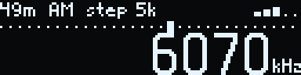

The top row shows, from the left:

- the band name (`49m`),
- the mode (`AM`, `FM`, `LSB` or `USB`),
- the tuning step (`step 5k`),
- five signal bars at the right.

Below the top row a dotted line stands for the band. The marker on it shows where the frequency sits inside the band.
The frequency is in large digits, with its unit (`kHz` or `MHz`) at the bottom right.

### Tuning

Turn the wheel to tune. Each click moves the frequency by the step shown in the top row. There are no band edges.
AM, LSB and USB tune from 150 kHz to 30 MHz. FM tunes from 64 to 108 MHz. The band name follows the frequency.

Outside a named band the band name is `LW` below 300 kHz, `MW` below 1800 kHz and `SW` above. The band line is then
left out.

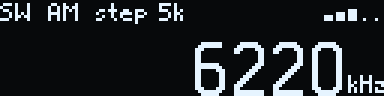

FM shows the frequency in MHz with two decimals. The band name and the mode both read `FM`.

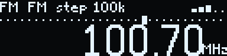

When an FM station sends RDS, its name (the PS, up to 8 characters) replaces the band name and the mode in the top
row. The name builds up character by character as the K-Radio receives it. A tune, a seek or a band change clears it
until the new station's name arrives.

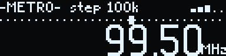

In LSB and USB, with a step of 10 Hz or 100 Hz, the frequency shows two decimals in kHz.

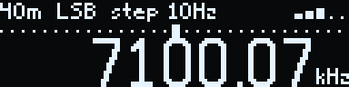

### The time

Once the K-Radio has set its clock from the network (see [Time](#time)), the bottom left of the home screen shows
the time in UTC, for example `13:05Z`. The `Z` marks UTC; the K-Radio has no local time. The time changes on the
minute. It is left out until the clock is set, and when the frequency leaves no room for it, as with a 10 Hz step
above 10 MHz.

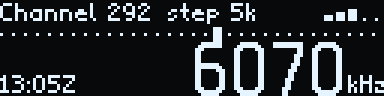

### What is on air

In AM, LSB and USB, once the clock is set, the top row shows the name of the station on air on the tuned frequency
in place of the band name and the mode, from the frequency guide (see [Station (frequency guide)](#station-frequency-guide)).
The name changes with the frequency at once. When several stations are on air within 1 kHz, their names take turns,
3 s each. A long name is cut with `…` before the signal bars (or before the `Mute` flag while muted), and the step
is then left out. Without the clock, without a guide or with nothing on air, the top row shows the band and the mode.

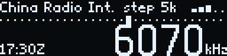

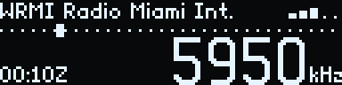

### Signal bars

The bars show the signal strength. The first bar lights at 10 dBµV on LW, MW and SW and at 15 dBµV on FM. Each
further bar needs 10 dBµV more. An unlit bar shows as a dot.

### Volume and mute

Hold the wheel down and turn it to set the volume. The top row then shows a speaker, a bar and the volume from 0 to
63. The top row returns 1.5 s after the last change. A change of volume also turns mute off.

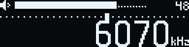

While the K-Radio is muted, the top row shows the `Mute` flag. In some languages the step is left out of the top row
while muted, so that the flag fits.

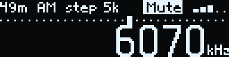

### Messages in the top row

Short messages replace the top row for 1.5 s, in inverted text.

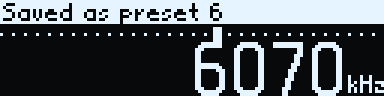

| Message | Cause |
|---|---|
| `Saved as preset 6` | A long press saved the frequency as preset 6. |
| `Presets full` | A long press found 20 presets already saved. |
| `No seek in SSB` | A seek was started in LSB or USB. |
| `Joining Telenor-5G` | A WiFi password was entered for the network Telenor-5G. |
| `Update cancelled` | A firmware update was cancelled on the K-Radio: an upload from the web page, or Settings > Firmware > Update. |

During a seek the top row shows the band and `Seek ▶` (up) or `Seek ◀` (down).

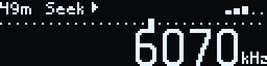

## The main menu

Press the wheel on the home screen to open the main menu. It opens with Volume selected, so a second press opens the
volume screen.

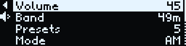

The screen shows four rows at a time. The selected row is inverted. The current value of each entry is at the right.
A dotted bar at the right edge shows that the list holds more entries than fit. The main menu holds, in order:

| Entry | Value shown | Press it to |
|---|---|---|
| Volume | the volume from 0 to 63, or `mute` | set the volume. See [Volume](#volume). |
| Band | the band, for example `49m`, or `SW` outside a named band | choose a band. See [Band](#band). |
| Presets | the number of saved presets | open the preset list. See [Presets](#presets). |
| Mode | `AM`, `LSB`, `USB` or `FM` | choose the mode. See [Mode](#mode). |
| Step | the tuning step | choose the step. See [Step](#step). |
| Bandwidth | the filter bandwidth | choose the bandwidth. See [Bandwidth](#bandwidth). |
| Seek | none | search for a station. See [Seek](#seek). |
| Station | none | on FM, show the station's RDS (see [Station (RDS)](#station-rds)); in AM, LSB and USB, list what the frequency guide has on the frequency (see [Station (frequency guide)](#station-frequency-guide)). |
| Settings | none | open Settings. See [Settings](#settings). |

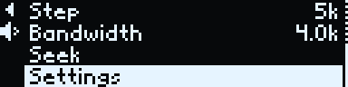

The narrow column at the left edge holds two controls that can be selected:

| Icon | Name | Press it to |
|---|---|---|
| `◀` | Back | return to the previous screen. On the main menu it returns to the home screen. |
| speaker | Mute | mute or unmute. The menu stays open. The speaker is crossed out while muted. |

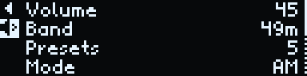

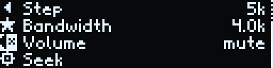

### Moving around a menu

These rules hold in every list.

- The selection travels round the screen in one loop. Turning clockwise moves down the entries. After the last entry
  the selection moves to the lowest icon in the left column, then up the column to Back, then to the first entry.
  Turning anticlockwise goes the other way, so one click up from the first entry selects Back. On the main menu the
  loop runs from Settings to Mute, then Back, then Volume.
- Hold + turn jumps four entries. It stops at the first and the last entry.
- A list opens with the current value selected.
- Choosing a band, mode, preset, step or bandwidth returns to the home screen.
- A long press returns to the home screen from any menu.
- After 8 s without input the K-Radio returns to the home screen. Text entry, the Station screen and the firmware
  update screen do not time out.

### Volume

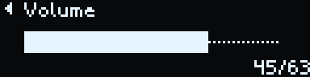

The volume screen shows a bar and the value out of 63. Turn the wheel to change the volume; it changes as the wheel
turns. Press the wheel to return to the home screen. A change of volume turns mute off. While the K-Radio is muted,
the main menu shows `mute` as the volume.

Hold + turn on the home screen sets the volume without opening the menu.

### Band

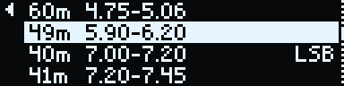

Each row shows the band's name and its range. LW and MW ranges are in kHz (`531-1602k`). The other ranges are in MHz
(`5.90-6.20`). Amateur bands carry `LSB` or `USB` at the right. The list runs from low to high frequency:

| Kind | Bands | Mode |
|---|---|---|
| FM broadcast | FM, 87.5 to 108 MHz | FM |
| Long and medium wave | LW, 153 to 279 kHz; MW, 531 to 1602 kHz | AM |
| Shortwave broadcast | 120, 90, 75, 60, 49, 41, 31, 25, 22, 19, 16, 13 and 11 m | AM |
| Amateur | 160, 80, 40, 20, 17, 15, 12 and 10 m | LSB below 10 MHz, USB above |
| Citizens band | CB, 26.965 to 27.405 MHz | AM |

Choosing a band tunes the K-Radio to the frequency last used in that band, in the band's mode. The K-Radio then
returns to the home screen. Each band remembers its own last frequency.

### Mode

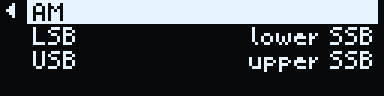

The modes are `AM`, `LSB` (`lower SSB`) and `USB` (`upper SSB`). LSB and USB receive single-sideband signals, which
radio amateurs use for voice. Choosing a mode keeps the frequency and returns to the home screen.

On FM the list holds only `FM`, marked `only on FM`. To leave FM, choose another band in the Band list.

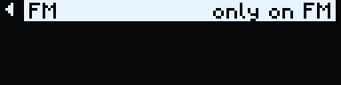

If the Mode list offers only AM outside FM, the firmware on the K-Radio has no SSB support. The amateur bands then
open in AM.

### Step

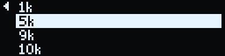

The step is how far one click of the wheel tunes. FM, AM and SSB (LSB and USB) each keep their own step.

| Mode | Steps |
|---|---|
| FM | `50k`, `100k`, `200k` |
| AM | `1k`, `5k`, `9k`, `10k` |
| LSB, USB | `10Hz`, `100Hz`, `1k`, `5k` |

MW stations sit 9 kHz apart in Europe, Africa and Asia and 10 kHz apart in the Americas. Seek uses the step as its
spacing. In LSB and USB, the 10 Hz and 100 Hz steps fine-tune a station until the voice sounds natural.

### Bandwidth

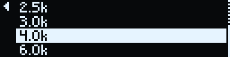

The bandwidth sets how wide a slice of the band the receiver lets through. A narrower bandwidth lets through less
noise and less of the neighbouring stations. A wider one carries more of the audio. FM, AM and SSB each keep their
own bandwidth.

| Mode | Bandwidths |
|---|---|
| FM | `Auto`, `110k`, `84k`, `60k`, `40k` |
| AM | `1.0k`, `1.8k`, `2.0k`, `2.5k`, `3.0k`, `4.0k`, `6.0k` |
| LSB, USB | `0.5k`, `1.0k`, `1.2k`, `2.2k`, `3.0k`, `4.0k` |

### Seek

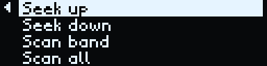

Choose `Seek up` or `Seek down`. The K-Radio returns to the home screen and searches for the next station in that
direction. It stops on the first station it finds. Inside a named band the search covers that band. Outside one it
covers LW, MW, SW or FM, whichever holds the frequency. At the end of the range the search wraps round to the other
end. The search moves in steps of the current step.

Turning the wheel, pressing it or pressing the side button stops a seek. Seek works on FM and AM. In LSB and USB the
K-Radio shows `No seek in SSB`.

## Station (RDS)

Many FM stations send RDS (Radio Data System) alongside the sound: the station's name, the kind of programme and a
line of text, often the song and artist or the show. The K-Radio shows them on FM. It does not switch frequency or
programme on its own because of RDS.

Open the main menu on FM, select `Station` and press.

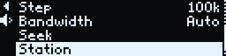

The top row shows the station's name at the left and the programme type at the right, for example `News`, `Pop
music` or `Weather`. The rows below show the RadioText, broken into lines at the spaces. When the text needs more than
three rows, turning the wheel scrolls it a row at a time. The screen follows the station while it is open: the text
changes as new characters arrive, and a new text starts again at its first row.

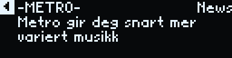

A station that sends a name but no text shows the top row alone. While the K-Radio receives no RDS, the screen shows
`No RDS`.

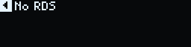

Press the wheel to return to the main menu. A long press returns to the home screen. The Station screen stays open
without input, so that a long text can be read to the end.

## Station (frequency guide)

In AM, LSB and USB the main menu's `Station` lists what broadcasts on the tuned frequency, from the frequency guide:
the [EiBi](http://www.eibispace.de/) shortwave schedule, compiled by Eike Bierwirth, converted into a table the
K-Radio reads from its flash. EiBi's README says: "any person is absolutely free to download, use, copy, or distribute
these files or to use them within third-party software." The guide covers LW, MW and SW broadcasts, utility stations
included. A new guide is loaded from Settings > Guide or from the web page; see [Guide](#guide).

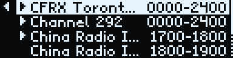

The list holds the entries within 1 kHz of the tuned frequency, at most 16: the station's name at the left, cut with
`…` when it is long, and its time window in UTC (`1700-1800`) at the right, or `irr` for a broadcast on irregular
days or dates. Once the clock is set, the entries on air come first, marked `▶`; the rest follow in order of their
start time from now. Without the clock the list runs in start time order from 0000, with no marks. The list follows
the time while it is open.

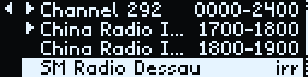

A press on an entry shows its details: the name, the time window with the days (`daily`, `Mo-Fr`, `Tu,Th`, `irr`),
the language and the target area. The days, language and target codes are EiBi's, as EiBi writes them: `Tu,Th` is
Tuesday and Thursday, `D` is German, `CAs` is Central Asia. The days are the UTC day a broadcast starts. EiBi's
README explains every code.

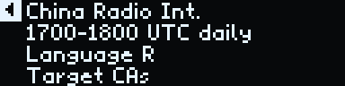

`Nothing listed on 6075 kHz` means the guide has no entry within 1 kHz. `No guide` means the K-Radio has no valid
guide loaded.

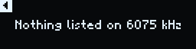

The screen closes after 8 s without input, as the menus do.

## Presets

A preset holds a frequency, a mode and a name of up to 10 characters. The K-Radio holds up to 20 presets.

### Saving a preset

Long-press the wheel on the home screen. The top row shows `Saved as preset 6`, with the new preset's number. On FM,
when the top row shows the station's RDS name, the preset is named after the station, for example `-METRO-`.
Otherwise it is named after the band, for example `49m`, or `SW` outside a named band. With 20 presets saved, the K-Radio
shows `Presets full` and saves nothing.

### Choosing a preset

Open the main menu, select `Presets` and press. The main menu shows the number of saved presets at the right. With no
presets saved the list is empty and opens with Back selected.

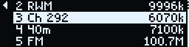

Each row shows the preset's number and name, with its frequency at the right (`9996k`, or `100.7M` on FM). The list
opens on the preset at the current frequency. Choosing a preset tunes to it, in its own mode, and returns to the home
screen. An empty list opens with Back selected.

### Editing presets

The K-Radio has no screens for renaming, moving or deleting presets. The [web page](#the-web-page) does this. It can
also save the current frequency under a name of choice.

## The lamp

The lamp is the six white LEDs on the back of the K-Radio. It is off when the K-Radio is switched on.

Hold the side button for 1 s to turn the lamp on. The lamp screen opens with it. Hold the side button for 1 s again
to turn the lamp off, from any screen; if the lamp screen is open, it closes. Settings > Light also opens the lamp
screen.

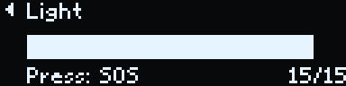

On the lamp screen:

- Turning the wheel sets the level from 1 to 15. The lamp follows at once. The level is kept when the K-Radio is
  switched off.
- Pressing the wheel goes from on to SOS, and from SOS to off. Off closes the screen. The bottom left shows what the
  next press does: `Press: SOS` or `Press: off`.
- The side button returns to the screen before, and a long press goes to the home screen. The screen also closes
  after 8 s without input. Leaving the screen leaves the lamp as it is.

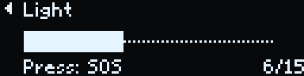

In SOS the title reads `Light SOS` and the lamp flashes SOS in Morse code (`... --- ...`) at the level: a dot is
0.3 s on, a dash 0.9 s, with 0.3 s off inside a letter, 0.9 s between letters and 2.1 s before it starts again. It
starts with the first dot when SOS is chosen and keeps flashing whatever the screen shows.

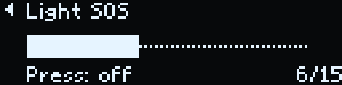

## Settings

Open the main menu, select `Settings`, its last entry, and press. From Volume, three clicks anticlockwise, past Back
and Mute, select it.

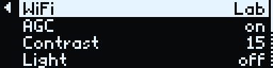

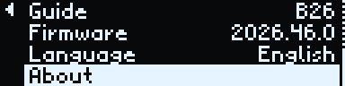

| Entry | Value shown | Press it to |
|---|---|---|
| WiFi | the joined network, or `not joined` | open the WiFi list |
| AGC | `on` or `off` | switch AGC on or off |
| Contrast | 1 to 15 | set the screen contrast |
| Light | `off`, the lamp level (1 to 15) while the lamp is on, or `SOS` | open the lamp screen |
| Time | the time in UTC, or `--:--` before the clock is set | open the Time list |
| Guide | the frequency guide's season (`B26`), or nothing without a guide | open the Guide list |
| Firmware | the Havoc Radio version | open the Firmware list |
| Language | the language's name | choose the language |
| About | | show the version, address, battery level and time |

Back in Settings returns to the main menu.

### WiFi

After the splash, the K-Radio joins the WiFi network it has saved. If it has none, or cannot join it within 15 s, it
starts its own open access point `Havoc-Radio` at `192.168.4.1`. It keeps looking for the saved network meanwhile.

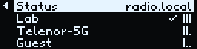

The first row, `Status`, shows `radio.local` when the K-Radio has joined a network and `not joined` when it has not.
The rows below list the networks the K-Radio found nearby, each with one to three signal bars. A tick marks the
joined network.

Press `Status` to see the connection. When the K-Radio has joined a network, the screen shows the network's name,
`radio.local` and the K-Radio's address. When it has not, the screen shows the access point `Havoc-Radio`. Press the wheel to return.

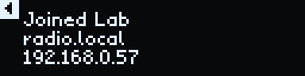

To join a network:

1. Select the network in the list and press. The password screen opens.
2. Type the password, as described in [Typing a WiFi password](#typing-a-wifi-password). For an open network, type
   nothing.
3. Choose `OK`. The K-Radio returns to the home screen and shows `Joining` with the network's name.

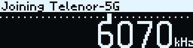

Open Settings > WiFi afterwards to check the result. The [web page](#the-web-page) can also set the network and
password.

### AGC

AGC (automatic gain control) evens out the level of strong and weak signals. Press the AGC row to switch it between
`on` and `off`. The selection stays on the row.

### Contrast

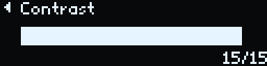

Contrast sets the screen's brightness from 1 to 15. Turn the wheel to change it; the screen changes as the wheel
turns. Press the wheel to return to Settings.

### Light

The Light row shows the lamp: `off`, its level while it is on, or `SOS`. Pressing it opens the
[lamp screen](#the-lamp) and turns the lamp on if it is off. Back on the lamp screen returns to Settings.

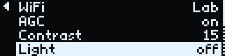

### Time

The K-Radio has no clock that runs while it is switched off. It sets its clock from an NTP time server on the
internet while it is joined to a network. The first time comes within a few seconds of joining, and the clock is
set again every hour. Between those it runs on the K-Radio's own crystal. The time stays set until the K-Radio is
switched off, also when the network is lost or time sync is turned off. On its own access point the K-Radio cannot
reach a time server, so the clock stays unset. All times are UTC.

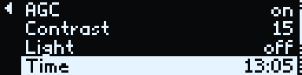

The Time entry shows the time. Pressing it opens the Time list:

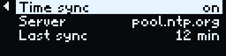

| Entry | Value shown | Press it to |
|---|---|---|
| Time sync | `on` or `off` | switch time sync on or off |
| Server | the NTP server | change the server |
| Last sync | how long ago the clock was last set (`12 min`, `3 h`), or `never` | (it cannot be selected) |

Time sync is on from the start. With time sync off the K-Radio makes no connections outside the local network.

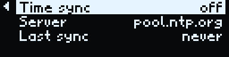

The server is `pool.ntp.org` from the start. Pressing Server opens the text entry screen titled `NTP server`, with
the current server filled in and `OK` selected; see [Typing a WiFi password](#typing-a-wifi-password) for how the
screen works. A server is a host name or an IPv4 address of at most 63 letters, digits, dots (`.`) and hyphens
(`-`): the `abc`, `123` and `#+=` groups hold them all. `OK` stores the server and returns to the Time list; an
empty server stores `pool.ntp.org`. A server with any other character is not stored. A long press cancels. A long
server is cut with `…` in the Time list.

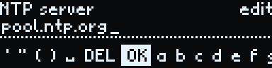

The clock uses the new server from its next sync.

### Guide

The frequency guide is EiBi's schedule for the season: `A26` from the last Sunday of March 2026, `B26` from the last
Sunday of October. EiBi revises it during the season. The data repository
[eibi-binary-table](https://github.com/hoverboardhavoc/eibi-binary-table) keeps a converted copy current; the K-Radio
or its web page downloads it from there on request. Nothing downloads on its own: there is no check at start-up and
no timer.

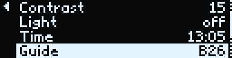

Pressing Guide opens the Guide list: `EiBi` with the season and the number of entries, which cannot be selected, and
`Update guide`.

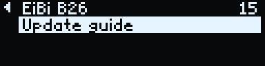

Pressing `Update guide` restarts the K-Radio into a download mode. It needs a saved WiFi network: without one the
entry shows `No network` and a press does nothing.

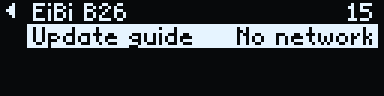

The download mode runs on its own, with the receiver off and the web page unavailable, because the secure connection
to GitHub takes more memory than the K-Radio has to spare while it plays. The screen shows `Updating guide` and the
step: `Joining` the network (at most 20 s), `Checking` whether a new guide exists, and `Downloading`, with a bar and
the kilobytes received. The side button (Back) cancels at any step. The whole mode takes at most 90 s.

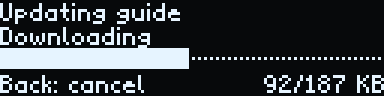

The K-Radio then restarts into the normal home screen and shows the result in the top row for 3 s: `Guide updated`,
`Up to date` (the loaded guide is the current one), `No network` (the network could not be joined), `Download failed`
or `Guide check failed` (the table did not pass the K-Radio's checks). After a cancel it shows nothing.

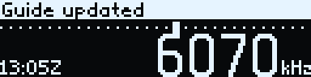

The same download can be started over the network with `POST http://radio.local/api/guide/update`: without a saved
network the K-Radio answers 409 with `{"error": "no network"}`; otherwise it answers 202 and restarts into the
download mode. `GET /api/guide` describes the loaded guide (season, entries, length, SHA-256 and EiBi's date) and,
after a download since power-up, its `last_update`: the kind of the last download (`guide` or `firmware`), the result
(`updated`, `up to date`, `no network`, `download failed`, `check failed` or `cancelled`), the step it ended in and
the lowest free heap.

The new guide is written beside the loaded one and checked before it replaces it. A failed, cancelled or cut-off
download, also one cut by switching off, leaves the loaded guide in use. The download checks the table's SHA-256
against the data repository's manifest; the connection itself does not verify GitHub's certificate. The guide can
also be loaded from the web page, where `From file` takes a table from any source; see [The web page](#the-web-page).

### Firmware

Firmware shows the running Havoc Radio version. Nothing checks for new firmware on its own: an update starts only
from `Update` here or from the web page.

Pressing Firmware opens the Firmware list: `Version` with the version, which cannot be selected, and `Update`.

Pressing `Update` restarts the K-Radio into the download mode described under [Guide](#guide), titled
`Updating firmware`. It needs a saved WiFi network: without one the entry shows `No network` and a press does
nothing.

The download mode joins the network and fetches the manifest of the latest release from the `firmware` branch of the
havoc-radio repository on GitHub. When that release is not newer than the running version, the K-Radio restarts and
shows `Up to date`. When it is newer, the K-Radio asks before anything is written:

A press installs. A long press, the side button or 30 s without a press cancels; the K-Radio restarts and shows
`Update cancelled`. After a press the image is downloaded into the app slot that is not running, with a bar and the
kilobytes received. The side button cancels during the download as well. The whole mode takes at most 240 s.

The image's length and SHA-256 must match the manifest, and the image must pass the SDK's check of an app image. Only
then is the new slot selected for the next start. The K-Radio restarts into the new firmware and shows
`Firmware updated` in the top row for 3 s. `Download failed` means the download failed or did not match the manifest,
and `Image check failed` that the image is not a valid app. After a failure or a cancel, also after switching off
during the download, the running firmware stays and starts as before.

The same update can be started over the network with `POST http://radio.local/api/firmware/update`, which skips the
question on the K-Radio: without a saved network the K-Radio answers 409 with `{"error": "no network"}`; otherwise it
answers 202 and restarts into the download mode. `GET /api/firmware` gives the version, the running app slot (`ota_0`
or `ota_1`) and, after a download since power-up, `last_update` as in `GET /api/guide`. The web page's
`Check for update` uses these.

The image is not signed. The manifest's SHA-256 guards against a damaged or cut-off download, and the SDK's check
against a file that is not an app; the connection does not verify GitHub's certificate. An uploaded image is checked
the same way by the SDK, after a press on the K-Radio.

### Language

The K-Radio speaks 41 languages. Each one is listed under its own name: English, Norsk, Svenska, Dansk, Deutsch,
Français, Español, Italiano, Nederlands, Polski, Čeština, Português, Suomi, Afrikaans, Català, Galego, Euskara,
Gaeilge, Shqip, Bahasa Indonesia, Bahasa Melayu, Kiswahili, Tagalog, Walon, Íslenska, Føroyskt, Eesti, Slovenčina,
Hrvatski, Bosanski, Slovenščina, Srpski (Latin), Magyar, Română, Türkçe, Azərbaycanca, Latviešu, Lietuvių, Malti,
Cymraeg and Esperanto.

Choosing a language changes the K-Radio and the web page at once. The K-Radio returns to Settings. Units, band names
and mode names read the same in every language. Some translations use short forms to fit the screen.

### About

About shows the Havoc Radio version, the K-Radio's address on the network, the battery level and the time in UTC.
On its own access point the address is `192.168.4.1`. The battery level is read every 10 s. Before the clock is set
the last line reads `UTC not set`. Press the wheel to return.

## Typing a WiFi password

The password screen opens when a network is chosen in Settings > WiFi.

- The top row shows `Password for` and the network's name. The current group of characters is at the right.
- The second row shows the typed text and a caret. Long text scrolls so that its end stays in view.
- The bottom row is the character ring. The selected character is in the middle, inverted.

The ring holds five groups, in this order:

| Group | Characters |
|---|---|
| `abc` | `a` to `z` |
| `ABC` | `A` to `Z` |
| `123` | `0` to `9` |
| `#+=` | `! @ # $ % & * - _ . + = ? / : ; , ' " ( )` |
| `edit` | `␣` (space), `DEL`, `OK` |

The ring wraps round: after `OK` comes `a` again.

### Typing

1. Turn the wheel to bring a character to the middle.
2. Press the wheel to type it.
3. Hold the wheel down and turn it to jump to the first character of the next group (clockwise) or the previous group
   (anticlockwise).

### Editing and finishing

- `␣` types a space.
- `DEL` deletes the last character.
- `OK` saves the password and joins the network.

A long press cancels and returns to the home screen. The side button cancels and returns to the WiFi list. The
password screen does not time out. A password holds at most 64 characters.

## The web page

The K-Radio serves a web page on the local network. A phone or computer on the same network opens it in a browser.

### Opening the page

- When the K-Radio has joined a network, open `http://radio.local`. If that name does not open, use the address
  shown in Settings > WiFi > Status or in Settings > About, for example `http://192.168.0.57`.
- When the K-Radio runs its own access point, join the open network `Havoc-Radio` and open `http://192.168.4.1`.

### What it does

The page has three views, `Radio`, `Settings` and `Screen`, with links at the top. The Settings and Screen views have
their own addresses, `http://radio.local/#settings` and `http://radio.local/#screen`. Below the links the page shows
the K-Radio's time in the browser's time zone and in UTC, or `time not set` before the K-Radio has set its clock.

The Radio view:

- It shows the frequency, band, mode and signal, and updates them twice a second. The signal shows as bars, with the
  strength in dBµV and the signal-to-noise ratio in dB.
- On FM, the frequency section also shows the station's RDS: its name, the RadioText, the programme type, `TP` when the
  station carries traffic news (highlighted during a traffic announcement) and the station code (`PI`). `Also on`
  lists the other frequencies that carry the same programme; a frequency there tunes the K-Radio to it. Without RDS
  it shows `RDS: searching`.
- In AM, LSB and USB, the frequency section lists the frequency guide's entries within 1 kHz, as on the K-Radio's
  Station screen: time, days, name, language and target, with the entries on air highlighted.
- The `-` and `+` buttons tune by the step. A frequency typed into the box (in MHz on FM, in kHz otherwise) tunes the
  K-Radio when `Tune` is pressed.
- Menus pick the band, mode, step and bandwidth. A slider sets the volume. A tick box mutes the K-Radio.
- Under `Presets`, a preset's name tunes it. The buttons beside it rename (✎), move up (↑), move down (↓) and delete
  (✕) the preset. `Add current` saves the current frequency under the name typed in the `Name` box.

The Settings view:

- Under `WiFi`, type the network's name into `Network` and its password into `Password`, then press `Join`.
- Under `Time`, the `Time sync (NTP)` tick box switches time sync on and off. `Save` stores the server typed in the
  box beside it, and `Default` sets `pool.ntp.org`. A server that is not a host name or an IPv4 address is refused,
  and the page shows `Failed`. Below, the section shows the K-Radio's time in UTC, this browser's own clock with its
  time zone, and how long ago the K-Radio last set its clock, from which server. A server set on the K-Radio shows
  on the page, and the reverse.
- Under `Guide`, the section shows the loaded frequency guide's season, EiBi's date and the number of entries, or
  `No guide`. `Update` fetches the data repository's manifest. When the K-Radio already has that guide the page shows
  `Up to date`; otherwise it downloads the table, checks its length and SHA-256 against the manifest and sends it to
  the K-Radio, with progress, then shows `Guide updated`. The download comes from GitHub to the phone or computer, so
  it needs that device to be on the internet: on the K-Radio's own access point it fails with a message pointing to
  `From file`. `From file` sends a `stations.bin` chosen on the device, for example one saved from the data
  repository. The K-Radio checks every table it receives and keeps its loaded guide when a table fails.
- Under `Firmware`, the section shows the version and the battery level. `Check for update` restarts the K-Radio
  into its download mode, which installs a newer release from GitHub without asking on the K-Radio (see
  [Firmware](#firmware)). The page says so, reconnects once the K-Radio is back, and then shows the result of the last
  check, for example `Last check: Up to date (2026.46.0).` `Upload` installs a firmware file (see
  [Firmware updates](#firmware-updates)).

The Screen view shows the K-Radio's screen as it is, enlarged four times. It reads the screen from
`GET http://radio.local/api/screen` about four times a second while the view is shown and the browser tab is in
front.

The page uses the language chosen on the K-Radio. It shows `No connection` beside the time while it cannot reach the
K-Radio.

The page has no password. Anyone on the same network can tune the K-Radio and change its presets. Installing an
uploaded firmware file needs a press of the wheel on the K-Radio itself. `Check for update` installs without a press,
but only the latest Havoc Radio release from GitHub. The K-Radio connects to the internet in two cases: to the NTP
server while time sync is on, and to GitHub (`raw.githubusercontent.com`) in the download mode that `Update guide`,
`Update` in Settings > Firmware or the web page's `Check for update` starts.

## Firmware updates

New Havoc Radio firmware installs in two ways:

- The K-Radio downloads the latest release itself, from Settings > Firmware > Update or from the web page's
  `Check for update`; see [Firmware](#firmware).
- A firmware file is uploaded from the web page. The file is `havoc-radio.bin`;
  [installer.md](installer.md#after-installing) says where it comes from. The steps follow.

1. Open the web page's Settings view. Under `Firmware`, choose the file and press `Upload`. The page shows "Press the knob on the
   radio within 30 s to install."
2. The K-Radio receives and checks the file, then shows the confirm screen.

   

3. Press the wheel within 30 s. The K-Radio shows `Installing` and restarts with the new firmware. The page shows
   "Installing. The radio restarts."

   

A long press, the side button or 30 s without a press cancels the update. The K-Radio then shows `Update cancelled`
on the home screen and keeps its current firmware. The page shows `Failed`.

While `Installing` shows, the K-Radio ignores the wheel and the side button.

## Battery

Charge the K-Radio through its USB-C port. Settings > About and the web page show the battery level.

When the battery runs empty, the K-Radio shows `Battery empty`. It mutes, switches off the receiver and the lamp,
and goes to sleep. It ignores the wheel and the side button from then on.

To start the K-Radio again, charge it, then slide the switch off and on.
